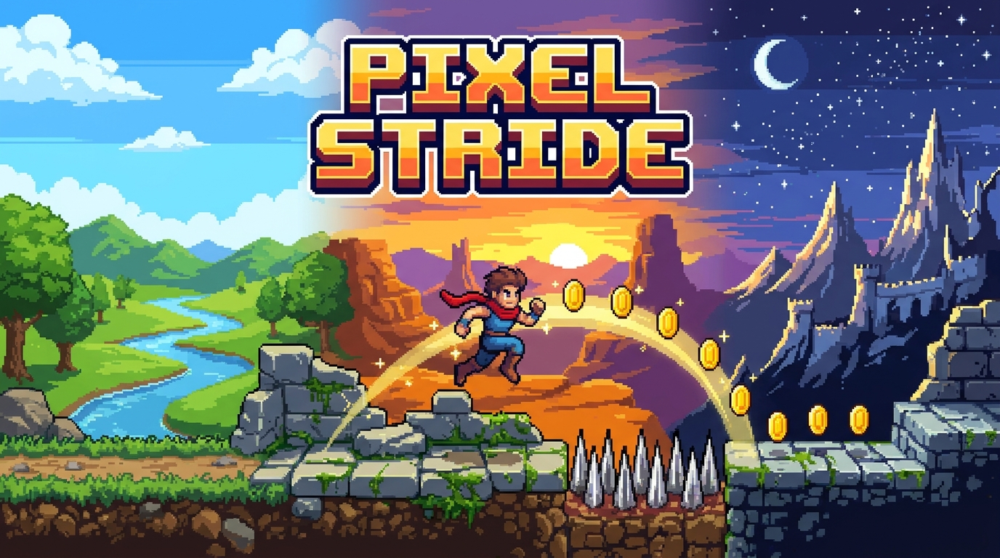

<p align="center">
  
</p>

<h1 align="center">PIXEL STRIDE</h1>

<p align="center">
  <strong>An 8-bit retro endless runner — 100% Native Kotlin on Android 17 (Zero WebView, ~789 KB APK) &amp; installable Web/PWA — with playable heroes, Hero Creator, Pixel Shop 2.0, 4 looping landscape levels, Winter Theme, Live Weather Sync, Mini-Bosses, Pets, and procedural chiptune audio.</strong>
</p>

<p align="center">
  <a href="LICENSE"></a>
  
  
  
  
  
</p>

---

## ✨ Features

### 🏃 Playable Roster & 8-Bit Hero Creator
| Character | Role | Unlock | Signature Perk |
| :--- | :--- | :--- | :--- |
| **STRIDE** | Male Runner | Default | `+25%` Stomp Bonus |
| **LILY** | Female Runner | Default | Passive Coin Aura + Blossom Petals |
| **PIXEL KNIGHT** | Armored Hero | Default (Native) / 100C (Web) | Starts every run with **4 Hearts** |
| **CUSTOM HERO** | Hero Creator | Default | Custom Hair, Tunic, Scarf & Boots palette |

### 🛒 Pixel Shop 2.0 — Wardrobe, Gadgets, Boosters & Upgrades
- **Wardrobe (Live on Any Hero):**
  - **5 Pixel-Art Hats:** `Santa Hat`, `Gold Crown`, `Wizard Hat`, `Cyber Visor`, and floating `Gold Halo`.
  - **3 Back Accessories:** flowing `Hero Cape`, thruster `Jetpack`, and flapping `Angel Wings`.
  - **3 Pet Companions:** `🦊 Pixel Fox` (`95px` coin fetch), `🦉 Frost Owl` (`+10%` score), and `🐉 Mini Dragon` (zaps 1 visible hazard every `20s` for `+75 ZAP!`).
  - **4 Runner Trails:** `Classic`, `Rainbow`, `Blossom`, and `Ember`.
- **5 Equippable Gadgets (2 Active Slots + Unlockable 3rd Slot):** Triple Jump, Coin Magnet, Score Boost, Shield Start, and Second Wind Revive.
- **Consumable Boosters & Permanent Upgrades (LV 0–3):** Turbo Start, Heart Flask, 2X Coins, plus permanent `MAGNET+`, `GOLD LUCK`, and `AEGIS+` upgrades and local **Top 5** leaderboard.

### 🐉 Mini-Bosses, 4 Game Modes & Trophy Room
- **4 Retro Mini-Boss Encounters (Every 90s / Level Transition):** Face **Iron Beetle**, **Sand Golem**, **Neon Drone**, and **Crystal Wyrm** with a live Boss HP bar, flashing `!` charge telegraphs, dedicated chiptune boss battle music, and **`+500 BOSS KO! +25 COINS`** + free Heart/Shield drop!
- **4 Game Modes:** `ENDLESS`, `DAILY` (deterministic daily seed `YYYY-MM-DD`), `HARDCORE` (**1 HP**, `1.25×` speed, **2× Coins & Score**), and `BOSS RUSH`.
- **🏆 Trophy Room (12 Achievements + Career Stats)** & **🃏 `640×900` Trading-Card Run Card PNG** with 1-tap native **Share PNG** or **Save to Gallery**.

### 🌍 4 Looping Landscapes, 6 Biomes, Day/Night Cycle & Live Weather
- **4 Stepped Pixel-Art Landscapes:** **Highland Meadows** → **Pyramid Canyon** → **Starlight City** → **Crystal Peaks** with 16px NES ground & floating platform masonry.
- **Winter Wonderland Theme & Live Weather Sync:** Toggle `❄ WINTER` independently of game mode; sync real-world weather (`Clear`, `Rain`, `Storm`, `Snow`, `Fog`) + Day/Night via **Open-Meteo** & native Android single-shot GPS (`LocationManager.getCurrentLocation`), complete with shimmering puddles, splash crowns, underground water trickles, and hanging icicles.
- **Procedural Chiptune Audio & Hardware Controls:** 6 biome loops + Boss Battle theme + 4-channel polyphonic SFX (`AudioTrack` on Android / Web Audio API on Web), plus Touch, Hardware Keyboard, and Bluetooth Gamepad support.

---

## 📦 Downloads & Releases

Pre-built **Native Android 17** and **Web/PWA** packages are published on the [GitHub Releases](https://github.com/gabigtr123/Pixel-Pride-Runner-/releases) page:

| Platform | Latest Release | Artifact | How to Run / Install |
| :--- | :--- | :--- | :--- |
| **Android 17 Signed Native APK (Zero WebView)** | [`v4.0.0`](https://github.com/gabigtr123/Pixel-Pride-Runner-/releases/tag/v4.0.0) | `pixel-stride-v4.0.0-android.apk` | **~789 KB** pure Kotlin APK (`com.gabigtr123.pixelstride`, API 37). Upgrades directly over `v3.0.3` with the same release keystore. |
| **Android / Web PWA (Live)** | [Play / Install PWA](https://gabigtr123.github.io/Pixel-Pride-Runner-/) | GitHub Pages | Open in Chrome on Android and tap **Install app** — full-screen offline play, automatic updates. |
| **Web (Static Bundle)** | [`v4.0.0`](https://github.com/gabigtr123/Pixel-Pride-Runner-/releases/tag/v4.0.0) | `pixel-stride-v4.0.0-web.zip` | Unzip and serve with any static host (`npx serve .`, Netlify, Vercel, or GitHub Pages). |

---

## 🎮 Controls

| Action | Keyboard / Bluetooth Gamepad | Touch |
| :--- | :--- | :--- |
| **Start / Restart / Resume** | `Space`, `↑`, `W`, or `Button A` | Tap **START RUN / TRY AGAIN / RESUME** |
| **Jump / Double / Triple Jump** | `Space`, `↑`, `W`, or `Button A` *(hold for higher jump)* | Tap / hold right side or **▲ JUMP** button |
| **Duck / Slide / Platform Drop-Through** | `↓`, `S`, or `Button B` | Hold left side or **▼ DUCK** button |
| **Pause / Close Modal / Back** | `P`, `Esc`, `Start`, or Android **Predictive Back** | Tap **II** HUD icon or **X** |
| **Mute / Unmute Audio** | `M` | Tap **SFX / OFF** button |

---

## 🚀 Getting Started

### Native Android 17 (Kotlin / Zero WebView)

Requires **JDK 21**, **Gradle 9.8.2**, and **Android 17 SDK (API 37)**:

```bash
cd android-native

# Run Kotlin JVM unit tests (GameEngineTest)
gradle testDebugUnitTest

# Build R8-minified release APK
gradle assembleRelease
```

### Web & PWA (Vite / React / TypeScript)

Requires **Node.js 24+** and **npm 10+**:

```bash
npm install
npm run dev      # Dev server on http://localhost:3000
npm run lint     # TypeScript type-check (tsc --noEmit)
npm test         # 26 deterministic unit tests (tsx --test)
npm run build    # Production bundle into dist/
```

### Automated CI & Releases (GitHub Actions)

- Every push to `main` and Pull Request runs **Web tests + Kotlin JVM unit tests** via `.github/workflows/ci.yml`.
- Pushing a stable tag `v*` (e.g., `v4.0.0`) runs all tests, signs & verifies the **100% Native Android 17 APK** + **Web/PWA zip**, and publishes a unified GitHub Release via `.github/workflows/release.yml`.
- Every push to `main` deploys the live PWA to GitHub Pages via `.github/workflows/deploy-pages.yml`.

---

## 🗂️ Project Structure

```text
Pixel-Pride-Runner-/
├── .github/
│   ├── ISSUE_TEMPLATE/         # Bug report & feature request forms
│   ├── workflows/
│   │   ├── deploy-pages.yml    # Auto-deploy live PWA to GitHub Pages on main
│   │   └── release.yml         # Unified Android 17 Signed APK + Web zip release
│   └── PULL_REQUEST_TEMPLATE.md
├── assets/
│   └── banner.jpg              # README pixel-art banner (4 heroes + dynamic weather)
├── public/
│   ├── icon-192.png            # PWA 192×192 pixel-art icon
│   ├── icon-512.png            # PWA 512×512 pixel-art icon
│   ├── icon.svg                # Crisp SVG pixel-art favicon
│   ├── manifest.webmanifest    # Installable PWA manifest
│   └── sw.js                   # Offline-capable Service Worker
├── scripts/
│   └── apply-android-icons.mjs # Generates Android Adaptive & Material You monochrome icons
├── src/
│   ├── components/
│   │   ├── CreatorModal.tsx    # 8-bit Hero Creator (Male/Female, presets & mission unlocks)
│   │   ├── DailyModal.tsx      # Daily Quests & 7-day streak bonus modal
│   │   ├── GameHud.tsx         # Score, LV/cycle progress, HP, power-ups, touch controls
│   │   ├── PixelIcons.tsx      # Crisp pixel-art SVG UI icons & character previews
│   │   ├── ShopModal.tsx       # Pixel Shop 2.0 (Gear, Wardrobe, Gadgets/Boosters, Top 5)
│   │   ├── StatusModal.tsx     # Pause & Game Over overlays with level & mission unlocks
│   │   ├── TitleOverlay.tsx    # Title screen, Daily/Shop/Weather/Creator & hero selector
│   │   └── WeatherModal.tsx    # Winter Theme, Day/Night cycle & Live Weather Sync
│   ├── game/
│   │   ├── audio.ts            # Procedural Web Audio chiptune soundtrack (6 biomes) & SFX
│   │   ├── constants.ts        # Physics tuning, 4 level names, 30s cycle & 6 biome palettes
│   │   ├── creator.ts          # Custom hero sprite composer, English presets & unlocks
│   │   ├── daily.ts            # Deterministic Daily Missions & 7-day streak engine
│   │   ├── engine.ts           # Simulation, 3-cycle levels, Gadgets, Boosters, Turbo Dash
│   │   ├── engine.test.ts      # 20 seeded unit tests (physics, levels, shop 2.0, weather)
│   │   ├── haptics.ts          # Tactile vibration helper for Android & mobile browsers
│   │   ├── renderer.ts         # 4 landscapes, Wardrobe gear, Day/Night & weather terrain
│   │   ├── shop.ts             # Coin bank, Wardrobe, Gadgets (+3rd slot), Boosters, Top 5
│   │   ├── sprites.ts          # 8-bit sprite matrices (Stride, Lily, Knight, pickups)
│   │   ├── types.ts            # Core state, wardrobe, gadgets, boosters, HUD & audio types
│   │   └── weather.ts          # Winter Wonderland palette, Day/Night & Open-Meteo sync
│   ├── App.tsx                 # Main game loop, modal/input hub & React HUD bridge
│   ├── index.css               # Retro pixel styling, safe-area & Tailwind CSS v4
│   └── main.tsx                # Entry point & PWA Service Worker registration
├── capacitor.config.json       # Capacitor 9 Android configuration
├── index.html
├── package.json
├── tsconfig.json
└── vite.config.ts
```

---

## 🤝 Contributing

Contributions, bug reports, and feature ideas are welcome! Please read [CONTRIBUTING.md](CONTRIBUTING.md) before opening a pull request.

---

## 📄 License

This project is licensed under the **MIT License** — see the [LICENSE](LICENSE) file for details.
